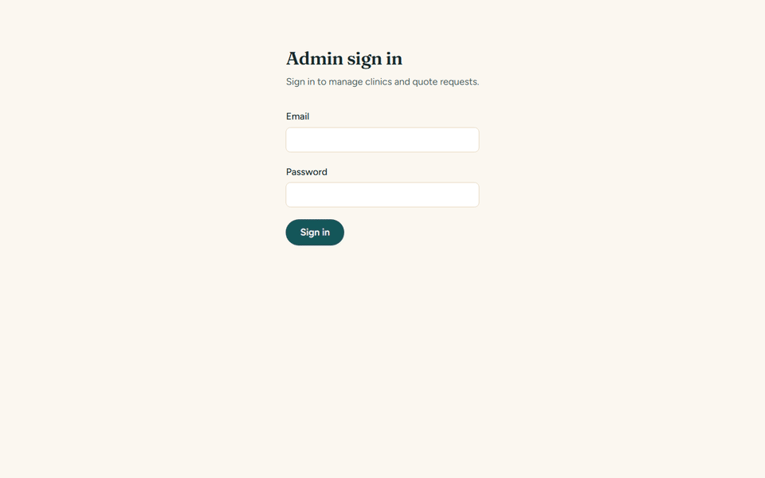

# Dental Implants Clinic Directory (demo)

A clinic comparison site for dental implants in Vietnam, with a public directory and an admin panel. All clinics, prices and photos are fictional demo data.



## What it does

- Treatment page with hero, comparison table, filterable clinic cards (city filter, price sort) and guide content.
- Clinic profile with photo gallery, price tiers with inclusions, sticky enquiry card, mobile bottom bar and similar clinics.
- Enquiry form with validation that focuses the first invalid field.
- Admin panel: login, clinic CRUD with publish toggle, multi-photo upload (downscaled to 1200px JPEG in the browser), price tiers, enquiry list with status filter and detail view.

## Stack

Next.js (App Router), React, TypeScript, Tailwind CSS 4, Vitest, Playwright.

## Run locally

```bash
npm install
npm run dev
```

Other scripts: `npm run build`, `npm run lint`, `npm test`.

Admin login at `/admin/login` (demo credentials, visible in `lib/demo-auth.ts`, they protect nothing):

- Email: `demo@implants.example`
- Password: `demo-admin-2026`

## Data layer

There is no backend. Types, seed data and a `useSyncExternalStore` store (`lib/store.ts`) replace a database and persist to `localStorage`. Pages render the seed on the server and switch to stored data after hydration. This keeps the demo deployable without credentials. It is a deliberate shortcut, not a production design: the original plan in `clinic-demo-prompts-v2.md` used Supabase with RLS, and the code moved to local storage in a later commit.

## Tests

- Unit tests (Vitest) in `tests/`: store, directory helpers (filter, sort, similar clinics), enquiry validation, clinic form, price and photo helpers.
- End-to-end test (Playwright) in `e2e/admin-flow.spec.ts`: log in, add a clinic with prices and two photos, confirm it appears on the treatment page, submit an enquiry and find it in the admin. The same run records `demo-admin-flow.gif` and the screenshots in `artifacts/`.

## How it was built

Built with Claude Code in phased sessions: schema and scaffold, seed data, public pages, admin, then an end-to-end run. Each phase was one prompt with explicit constraints and a fixed finish check: build, lint, tests, verify in the browser. The prompts are in [`clinic-demo-prompts-v2.md`](clinic-demo-prompts-v2.md) (notes in Ukrainian, prompts in English). The commit history follows the phases.

## Limitations

- Data lives in the visitor's browser only; nothing is shared between users.
- The admin login is a client-side demo gate, not authentication.
- Photos are stored as data URLs in `localStorage`, which limits how many fit.
